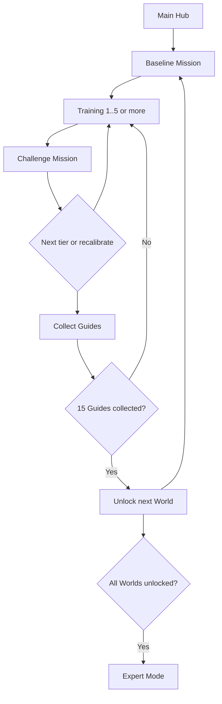

# FOCUS DRIVE — EndeavorOTC高忠実度再現設計書 v2.0

> **設計日**: 2026-10-18  
> **状態**: 個人開発向け実装指示書 / 未実装  
> **対象**: デスクトップブラウザを先行、モバイル/PWAは段階対応  
> **コンセプト**: *EndeavorOTCの公開仕様をできる限り忠実に車ゲームへ移植し、車としても魅力的にする。*  
> **参考研究・一次資料**: EndeavorOTC Instructions for Use (2025)、EndeavorOTC公式サイト、Stamatis et al. (2024)、NeuroRacer (Anguera et al. 2013)

## 0. エグゼクティブサマリー

**FOCUS DRIVE** は、EndeavorOTCの「Navigate / Target / 両者の同時課題」「難易度の常時適応」「ワールド、ミッション、ガイド収集、スコア、報酬」という公開された体験と数理要素を、**自動前進する精密3D車ゲーム**に置き換えたWebアプリ。ゲームの仕組みは可能な限り原作と一致させ、車という題材に固有の部分だけ作り直す。

**優先順位：再現忠実性 > 入力と刺激の計測精度 > 車としての気持ちよさ > 画面の豪華さ。**

### 0.1 今回の変更

- 「Endeavor風オリジナル」として勝手に変更する方向を撤回。**EndeavorOTCの公開仕様を再現する**ことを第一目標に変更。
- 公式説明書にある**Power Zones / 障害物 / タップ入力 / Guideへの自動ロックオンと捕獲 / 15 GuidesでWorld解放 / Expert Mode / Focus Scoreの15ミッション周期 / コイン・コスチューム / 10 Mission Minutes**を追加。
- 原研究の200段階Road、54段階Sign、NeuroRacer classic staircaseと、AKL-T01の継続適応を併載し、**既知・推定・未確認の係数を区別したうえで一番近い挙動へ詰める**。
- CC BYモデルは**投稿者への個別問い合わせを要求せず**、公開ライセンスに基づいて自動取り込み可能にする。最低限のクレジットを自動生成。
- 一般的な免責・権利確認のチェックリストを増やすのではなく、ゲームの仕様・計測・実装テストを最優先する。

### 0.2 要件優先順位

|優先|要件|達成条件|
|---|---|---|
|P0|EndeavorOTC二重課題|自動前進＋運転しながらGo/No-Go刺激に反応。単独/同時課題は独立記録|
|P0|原作系のリアルタイム適応|Navigation、Targetingを別々に連続調整。Classicモードでは2013研究準拠|
|P0|原作特有の進行ループ|Baseline、Training、Challenge、Guide、World、Expert、Focus-styleスコア|
|P0|車の快適な操作|ステアリングの気持ちよさ、Power Zones、障害物、精密スポーツカー|
|P0|正確な測定|刺激提示、入力、走行偏差、FPS、難易度変化をログに残す|
|P1|精密3Dとガレージ|Sketchfab CC BYアセット、LOD、塗装、車両コレクション|
|P1|Mission Minutesとミッションハブ|ミッションのプレイ時間だけ集計し、報酬や進行と同期|
|P2|拡張Arcade|本筋の認知課題を変えずにカスタムイベントを追加|

### 0.3 アルゴリズム復元の姿勢

1. 公式IFUと論文にある**公開値は実装時に固定の回帰テスト**で照合。
2. 非公開SSMEの内部式は、公開の入出力挙動・論文の特徴量・観察したゲームプレイで近似。係数の欠落を理由に実装しない選択はしない。
3. 可能なら自分のプレイ映像、画面記録、操作タイムスタンプから各要素を較正する。記録ソフトは本人が所有・利用するゲーム体験に限定。
4. 「原作と一致を確認した数値」と「挙動を一致させるために推定した数値」は `fidelity-manifest.json` に残す。
5. 研究上のAttention指標や医療的な効果を、未検証のWebゲームにそのまま同一視しない。これは計測名・結果解釈の問題であり、再現機能を減らす理由にはしない。

---

## 1. 出典の扱い・再現可能性

再現仕様は **[P] EndeavorOTC公式説明書 / [N] NeuroRacer論文 / [S] AKL-T01研究 / [I] 実装推定 / [G] 車ゲーム上の置換** の5属性で管理する。論文の出典があるからといって現行EndeavorOTCの内部式と完全一致すると断定しない。

|構成|具体的な観察・研究値|属性|実装扱い|
|---|---|---|---|
|入力|傾けてNavigate、端末の左右半面のどこでもTap|[P]|車のステアリング＋画面半面タップ/キー操作|
|Navigation|Power Zoneを踏む・障害物を避ける|[P]|道路上のゲート、障害物、走行位置|
|Targeting|毎ミッション冒頭に示される正しい種類だけ収集|[P]|1 Target / distractorのGo/No-Go|
|進行|Guideへの自動ロックオン→数秒維持→捕獲、徐々に困難|[P]|Guide＝車版の追跡ドローン/信号ビーコン|
|World|Guide 15個で次World。全部解放後はExpert Mode|[P]|進行条件そのまま|
|Focus Score|15 Missionsごとに新スコアを解放|[P]|ゲーム内の独自合成値を同周期表示|
|Mission Minutes|1日10分の画面カウント、ミッション中だけ加算|[P]|同じ集計動作|
|難易度|秒単位で観測し、リアルタイム/セッション間で調節|[P/S]|独立2軸closed-loop|
|ミッション|Baseline→最低5 Training→Challenge|[S]|状態機械にそのまま反映|
|刺激|400ms表示、2/2.5/3秒ごとの提示|[N]|NeuroRacer Classicの既定値。OTCモードは設定で可変|
|難易度段階|Sign 54 / Road 200、約80%へstaircase|[N]|Classicの階段制御を再構成|
|W1/W2|W1: 色が異なる3刺激 / W2: 同色で形が異なる6刺激|[S]|公表された識別集合を再現|
|W3/W4|原作の正確な内容を確認できていない|[I]|仮実装後にプレイ観測データで置換|
|Focus-like index|Navigation80%閾値、Targeting RT、Targeting d′を統合|[S]|論文の分析パイプラインを実装|

**忠実度ゲート**：差異が出たら、まずゲームUIではなく `ReplayTrace`、`TrialGenerator`、`StimulusClock`、`Adapter`、`RuleSet` のどれが原因か切り分ける。

---

## 2. ゲームループ

### 2.1 基本フロー

1. Main HubでWorld/車を選び、進捗・Guide・Mission Minutes・Focus-like Scoreを確認。
2. 今回のMissionの指定Targetを確認。Baseline/Training/Challengeに応じて課題構成を選択。
3. 車は自動前進。チルト/スティック/A-Dで左右に操舵する。
4. 前方のPower Zonesへ入り、Gatesをくぐり、Obstaclesを回避。
5. 走行しながら正しい浮遊TargetだけをTap。似たTargetは無視。
6. 本編中にNavigation/Targetingの難易度が独立に、連続的に変わる。
7. 条件を満たすとGuideが出現。接近→自動ロックオン→数秒維持→捕獲。
8. ミッション終了時にCoins/Goals/Guide進捗を表示。15 Guidesで新Worldを解放。
9. 15 MissionsごとにFocus-like Scoreを更新。Worldをすべて解放したらExpert Mode。

**時間**: EndeavorOTC本編のミッション秒数は計測で確定させる構成値。NeuroRacer Classicのみ標準180秒を強制。

### 2.2 単独課題・同時課題

原作に近いのは**端末チルト＋画面左右どちらでもTap**。対象そのものの位置をタップするゲームではない。

|デバイス|Navigate（車の運転）|Targeting（選択反応）|設計|
|---|---|---|---|
|スマホ/タブレット|端末の左右傾斜をステア角に対応|左右どちらの画面半分でも1タップ|公式の操作分離を再現。傾斜許可できないときは仮想操舵|
|キーボード|`A/D` または矢印|`Space` または `J`|左右操作と選択反応を別指に分ける|
|ゲームパッド|左スティックX|右フェイスボタン|実際のゲームとして最も快適|
|デスクトップタッチ|仮想ステア|画面左/右半面タップ|同時タッチの競合を避ける|

- ステア入力は連続値、Tapは押下時刻の離散イベントとする。長押しで連打判定しない。
- 原作のタップは画面の右半面/左半面の**いずれの場所でもよい**。3D空間のターゲットへのRaycastを要求してはいけない。
- チルトのニュートラル姿勢、感度、デッドゾーン、入力遅延は初回セッションで較正。
- ブラウザで傾斜APIが許可されない端末ではゲームパッドかタッチ操舵へフォールバック。入力方式IDをログへ記録。

### 2.3 原作忠実モードとゲームモードを分離

- **`OTC_HIGH_FIDELITY`** [P/S/I]（**デフォルト**）: EndeavorOTCの3操作構造（Navigate / Tap / Multitask）、Power Zones・Gate・Obstacle、Guide捕獲、World、Baseline/Training/Challenge、リアルタイム適応、Main Hub報酬を再現する。
- **`NEURORACER_CLASSIC`** [N/I]: 元研究の3分ラン・400ms標識・2/2.5/3秒間隔・独立Staircaseで公開数値を厳密に比較する。
- **`ARCADE_DRIVE`** [G]: 本編の実力指標と区別した任意の自由走行、タイムアタック、フォトモード。開発優先度は本編より低い。

**UI起動時は`OTC_HIGH_FIDELITY`。** 数値が公開されていない箇所は実装を止めず、推定プロファイルで稼働させ、観測に応じて詰める。

## 3. ビジュアル / ドライビング体験

### 3.1 コンセプト

**ビジュアルはForza系の車の存在感、プレイフローはNeuroRacerの精密な二重課題。** 標準カメラはリアバンパーから少し引いたチェイスカメラ。自車の大きさは画面下部の15〜25%。道路中心と固定注視点を遮らない。HUDは最小化。

- 自動前進。実際の道路上の危険運転を模倣・推奨する仕様ではなく架空コースのみ。
- プレイヤーは左右ステアリングに集中。アクセル・ブレーキ・ギア変更は不要。
- ゆっくりした慣性とセルフセンタリング、路面への吸着、姿勢変化は視覚中心。
- 車種による加減速・旋回性能差をTrainingには持ち込まない。車は**見た目だけのスキン**。
- カーブや上下動で路面追従を難しくするが、プレイヤーが学習不可能な理不尽な挙動にはしない。
- `RESEARCH_CLASSIC`では過剰な画面振動、強いモーションブラー、カメラ回転を無効化。

### 3.2 操作

|デバイス|ステアリング|正解ターゲットへの反応|備考|
|---|---|---|---|
|キーボード|`A`/`D`、または←/→|`Space` または `J`|左手・右手を分ける|
|ゲームパッド|左スティック水平|A/X/右肩いずれか割り当て|原研究は左右手を分離|
|タッチ|左側スライダー/タッチステア|右側の大きな単独反応ボタン|端末別に必ず再較正|

反応操作は**標識を直接タップする操作ではなく専用ボタン**とする。理由: 画面内の見つけやすさと指の距離が毎回変わる影響を減らし、NeuroRacerのGo/No-Goに寄せるため。モバイルにも同等原理を維持する。

### 3.3 走行演出と「認知計測の分離」

- カメラ追従・排気音・ホイール回転・車体ロールは常時有効にできる。ただし刺激の時間精度に影響を与えない。
- 景観変更は基本ミッション**境界**で行う。環境アートはリアルだが、標識位置・背景コントラストを変えない。
- 走行中の派手な演出、広告、ポップアップ、ランダム交通車両の割り込みは研究・トレーニングでは禁止。
- ガレージ、塗装、デカール、ホイール、エンジンサウンドは**ご褒美**として提供。刺激判別スコアには無関係。
- `ARCADE_DRIVE`でのみコーナー脱出エフェクト、路面ギミック、スピード演出、特殊コース等を解禁。

### 3.4 「車を運転していて気持ちいい」を作る仕様 [O]

このゲームの自動前進は「ただ横に動く箱」ではない。アクセル操作を省いても**スポーツカーを扱う気持ちよさ**を実現する。とくに自車の存在感、コーナーを捉える視点、操作に対する滑らかな反応を重視する。

- **旋回**: 入力直後から車体が反応し、急に曲がると軽く外側へロール。過度な実車シミュレーションは避ける。
- **セルフセンタリング**: 操舵を戻すと無理なく走行姿勢が整う。勝手に道路中央へ完全自動追従してはいけない。
- **視覚的スピード**: 路面のテクスチャスクロール、白線の流れ、視野角のごく微小な調整で速さを感じる。ただしResearchモードではFOVを完全固定。
- **聴覚**: エンジン音の高低・路面音・軽い風切り音。Targetingの正誤を音で知らせる設定は用意するが、正誤判定前にターゲットを予告する音は絶対に出さない。
- **精細な車体**: 反射するボディ、回転ホイール、サスペンション風アニメーション、奥行きのあるキャビン。これらを`visualRig`に閉じ込め、`cognitiveEngine`へ影響させない。
- **速度感と難易度の独立**: 一見速く感じる演出がゲームの難易度を変えないよう、車の前進速度はRoad Levelからのみ算出する。
- **スムーズなリトライ**: 失敗後も事故ムービーを挟まず進行する。終了後に綺麗なリプレイ、ベストなコーナー走行を振り返れる。

### 3.5 世界観・ドライブの旅 [O]

**Worldごとに気分が変わるドライブコース**を用意する。ただし認知評価の公平性のため、コース背景は課題条件に影響しないよう検証し、異なる景観で取ったスコアはデータ上も区別する。

|ルート案|見た目|ドライブの気持ちよさ|計測時の制約|
|---|---|---|---|
|W1 — Coastal Dawn|朝焼けの海岸・遠景の橋|穏やかな流れ、ロードスターの解放感|中央注視点の背後に眩しい太陽を置かない|
|W2 — Alpine Pass|山岳ロード・森林・岩肌|連続コーナー、峠を抜ける感覚|樹木や標識がGo/No-Go刺激と似ない|
|W3 — Night Express|都会の夜景・高架道路|反射とネオン、滑らかな疾走感|点滅広告や巨大な光の変化を出さない|
|W4 — Sky Circuit|架空の未来道路・雲上の景観|非現実的な景色による達成感|視覚刺激の可読性・画面輝度を統制|

**道路生成は同じ数学モデル**を共有し、ワールドごとに演出/環境を差し替える。各Worldの生体認知課題は「外観によって難易度が変わるか」の検証ができるようログにコースIDを保存。見た目によって成績が有意に変わる場合、計測上は同じ条件としてまとめない。

### 3.6 ガレージと進行 [O]

- **Garage**: 3Dターンテーブル、S2000等のCC BYモデル、色・ホイール・内装を購入/変更。コインは実際のプレイに応じて獲得。
- **World進行**: **15 Guidesで次Worldを解放**。ラン数や所要日数だけで無条件解放しない。
- **Guide Collection**: 各Guideの捕獲達成記録を表示。次のGuideは捕獲難度が上がる。
- **Focus Score相当**: 15 MissionsごとにCompositeを更新。経過曲線、World別/難易度別の成績を見られる。
- **Expert Mode**: 全Worldが開いたら、好きなWorldを選択し、過去記録への挑戦・Goals・車カスタム収集を継続。
- **Arcade専用**: タイムアタック、コーナーコンボ、フォトモード。これらはOTC本編の進行解放条件を変更しない。

### 3.7 楽しさの受け入れ条件 [O]

- チュートリアル完了後30秒以内に「自分が車を操っている」感覚が得られる操作レスポンス。
- 複数の3分ランをプレイしても背景の使い回し感が少ないこと。景観演出は測定干渉しない範囲で更新。
- ユーザーテストでは`操作感 / 車の見た目 / もう一度走りたいか / 標識の見やすさ / 疲労感`を別々に5段階評価し、**面白さと計測品質の両方**を品質ゲートにする。
- 過度の視覚エフェクトや音が苦手な場合はすべて減衰/無効にでき、同時に成績への影響を記録する。

---

## 4. 道路生成とNavigation課題

### 4.1 道路セグメント [R/D]

- 車は自動前進し、道路が無限生成される。プレイヤーは左右ステアリングで道路の中央帯/指定走行ラインを追従する。
- **原作EndeavorOTCに合わせてPower Zone / Gate / Obstacleを同じNavigation時系列上に混在させる**。この構造は必須。
- `NavigationEvent` は `{id, kind: POWER_ZONE | GATE | OBSTACLE, atDistance, roadOffset, width, difficultyWeight, worldId, seed}`。
- Power Zone＝指示レーンに入って通過、Gate＝間をくぐる、Obstacle＝車体が重ならないように通過。どれも前方に適切な予告距離を取る。
- 各イベントの成功率を保存し、単なる道路中心誤差だけでNavigation成績を測らない。原作に合わせて、**通過対象と回避対象の両方**を学習する。
- NeuroRacer Classicでは2/2.5/3秒の道路セグメントと原論文の位置誤差スコアへ戻す。OTC本編とは別プロファイル。
- カーブ/障害物配置は固定seedで決定論的に再生できること。`roadDifficulty`が変わっても乱数列の再現性を担保する。
- ヨー・ロール・サスペンションの視覚表現は車モデル側で処理し、課題判定は仮想車幅・中心位置・イベント閾値による。

### 4.2 推奨座標系 [D]

```
progressS    : コースに沿った長さ [m]
centerX(S)   : 現在位置での道路中心（ワールド横座標）
carX         : プレイヤーの横位置
e(S)         = carX - centerX(S)
steer        : [-1,1]
carVX        : 横速度 [m/s]
forwardSpeed : 難易度で調節する前進速度 [m/s]
```

Fixed timestep `dt = 1/60 s` で積分する。自然な操舵モデルの例:

```
carVX += (steer * lateralAccel - carVX * lateralDamping) * dt
carX  += carVX * dt
progressS += forwardSpeed * dt
```

この単純式は**初期プロトタイプ**。[R]の実際の車両モデルではない。ゲームパッドではアナログ量、キーボードでは滑らかな立上がりを与える。慣性が大きすぎる場合は加速力と減衰を調整し、路面追従の主たる難しさが道路の曲率・速度に由来するようにする。

### 4.3 正確度 [R/D]

基本のNavigation accuracyは、定められた評価道路幅内に存在した実測時間割合。

```
roadAccuracy = validTimeInsideRoad / totalValidScoringTime
insideRoad   = abs(e) <= allowedHalfWidth
```

- 固定時間step単位で算出し、**FPS依存のフレーム数カウントを禁止**。
- 道路の中心線逸脱量 `meanAbs(e)` / `p95Abs(e)` も記録。
- 道路外に出たら、車の減点フィードバックのみ。派手な爆発・強制終了・急なカメラ切替は行わない。
- デッドゾーン / 入力遅延が異なるデバイスは別較正値で記録。
- 道路幅は視覚表現と評価用幅を別管理し、プレイヤーに分かるよう境界を表示。

### 4.4 Road難易度 [R/D]

- **200段階**のroad levelスキーマを持つ [R]。
- 現時点で確認できる原作情報は「200段階」「速度レンジが段階ごとに変化」等。**全200レベルの公式速度表は公開資料から復元できない**。
- FOCUS DRIVEでは可視のスピード・曲率・ターン間隔の基本構造を固定し、主に速度で難易度を上げる。[D]
- 推奨: `roadLevel ∈ [1,200]`、`forwardSpeed = monotonicLookup[level]`。lookupは実験調整可能な構成ファイル。
- カーブ頻度はすべての難易度で一定方向の偏りを避ける。難しさを単純に障害物の数で水増ししない。

---

## 5. Targeting課題

### 5.1 刺激規格 [R]

- 固定された注視点の近くに標識を出す。原NeuroRacerでは刺激は**400ms表示**。
- 刺激イベント間隔は**2.0 / 2.5 / 3.0秒**の疑似ランダム。[R]
- 180秒ランでおおむね**72試行**。原研究の条件には**24 Target/48 Non-target**（実験2・3）と**36/36**（実験1）の例があり、プロファイルとして選択可能にする。[R]
- 誤反応が発生した試行は重複してスコア計算しない。
- 反応ボタンの押下は押し始め時刻のみ。キーリピートや長押しによる複数ヒットは無視。

### 5.2 反応ウィンドウの扱い

**表示時間と許容反応時間は別物**。標識が400msで消えても、許容反応時間がたとえば500msなら、ターゲット提示から500ms以内の有効な押下を受け付ける。この仕様を混同しない。

- 原研究のSign難易度は**54段階**、応答窓はおよそ**250〜1000ms**。[R]
- 補足資料に `54→19レベルは10ms/level`、`19→1レベルは25ms/level` と書かれる一方、端点の四則計算上は小さな不整合があるため、**原作の正確な全レベル表が入手できるまでは、端点を満たす明示的なlookup表を別途採用する**。[D]
- `responseWindowMs` はレベル変更の度にルックアップ。内部の刺激オンセットを基準に判定する。
- `displayMs = 400`、`responseWindowMs ∈ [250,1000]` を別フィールドに保存。

### 5.3 試行状態機械

```
SCHEDULED → SHOWN → HIDDEN → CLOSED
               |                |
               └── input ───────┘
```

- Target＋有効な反応: `HIT`
- Target＋無反応、遅延反応: `MISS`
- Non-target＋反応: `FALSE_ALARM`
- Non-target＋無反応: `CORRECT_REJECTION`
- 空白期間の反応: `PREMATURE` として別記録。**前試行への誤帰属を防ぐ**。
- 提示の遅延やタブ背景化で未提示となった試行は `INVALID_PRESENTATION`、正答率母数に含めない。
- 欠損・破棄された試行が一定割合超過時はラン全体を`measurementInvalid`とする。

### 5.4 ワールド [R/O/U]

**原作で実際に確認できること**：毎ミッションの開始時に複数のターゲットが示され、指定された種類だけを取る。世界によってターゲット/非ターゲットのルールが変わる。[P/S]

|World|Targetingルール|Navigation/車側のテーマ|
|---|---|---|
|World 1|3種類の異なる色の物体。1 Target、2 distractors。[S]|海岸/明るい道路。Power ZoneとObstacle基本形|
|World 2|同色の6種類。1 Target、5 distractors。[S]|峠/林道。似た標識形状を見分ける|
|World 3|正確な原作ルールは観察対象。[I] 暫定は形状＋色の結合規則|夜間高速/環境難化。背景コントラストは正規化|
|World 4|正確な原作ルールは観察対象。[I] 暫定は直前指示に応じるルール切替|架空のスカイハイウェイ。標識ルールと道路の同時負荷|

- 色・形状・視点位置・表示サイズをWorldごとにJSON化。学習の段階的複雑化を維持。
- 正しい刺激は開始画面、ポーズ画面、必要なら小型HUDへ表示。
- World 3/4は固定の正解パターンを「公式」と断定せず、将来のゲームプレイ観測で修正できるようデータ駆動にする。

## 6. 適応難易度 — 最重要実装

### 6.1 原研究に基づく原理 [R]

1. TargetingとNavigationの難易度を**個別に較正**する。
2. 各々の単独成績が約80%になる課題レベルを推定する。
3. Dualモードでは両方の課題を並列に実施する。
4. 原NeuroRacerでは**各3分ランの終了時**に個別staircaseを更新する。
5. 両課題とも成績が80%を超えた場合のみ、全体達成の報酬/レベル上昇を許す。
6. AKL-T01のTrainingは**ミッション内でも連続適応**するが、原作SSMEの式は公開されていない。

### 6.2 公開されている閾値と例 [R]

NeuroRacerのMethodsではTargetingの比例型staircaseについて、次が記載される。

- 成績が**82.5%を超える**場合に次ランのSign難易度を増す。
- 約80%付近の変化帯で**約77.5〜82.5%は変更しない**。
- Signについて80%付近から離れる**約1.75パーセントポイントあたり1レベル**の調整幅。
- **90%の成績なら許容窓を約40ms短縮**、**55%以下なら約100ms延長**という実例。
- Road側も同様の比例設計で、**0.58パーセントポイントあたり1レベル**という記述。
- 較正初期値は**Road level 20 / Sign level 29**。

**実装方針:** 丸め処理・200段階の速度表・公開されていない係数は`reconstruction-profile.json`へ分離し、実測に基づき詰める。

### 6.3 v1 `classicStaircase` [D]

**方法**: 機構を透明にし、論文の例を再現する校正済みの可変関数とする。

```
function stepFromAccuracy(accuracy, bandLow, bandHigh, percentPerLevel, maxStep): int
    pct = 100 * accuracy
    if bandLow <= pct <= bandHigh: return 0
    anchor = (pct > bandHigh) ? bandHigh : bandLow
    raw = round(abs(pct - anchor) / percentPerLevel)
    step = clamp(max(1, raw), 1, maxStep)
    return (pct > bandHigh) ? +step : -step

signDelta = stepFromAccuracy(signAccuracy, 77.5, 82.5, 1.75, 10)
roadDelta = stepFromAccuracy(roadAccuracy, 77.5, 82.5, 0.58, config.maxRoadStep)
signLevel = clamp(signLevel + signDelta, 1, 54)
roadLevel = clamp(roadLevel + roadDelta, 1, 200)
```

上式は**再構成された実装案**。原文の `90%→40ms減` は現在のレベル帯で約4レベルになりうる。55%以下→100ms延長はレベル境界や最大ステップで再現する必要があるため、**論文例の回帰テストを通過するよう全レベル表と丸め方法を調整する**。このコードを「NeuroRacerと完全一致」と表現しない。

**不足データに対する挙動**:
- Target試行が8件未満またはNon-targetが8件未満なら、Signは更新しない。
- Navigationの有効計測時間がラン予定時間の90%未満なら、Roadは更新しない。
- 測定不正ランでは更新せず、「計測不成立」を表示。
- 低FPSを理由に認知能力が低いと推定してはいけない。

### 6.4 v1 `continuousAdapter` [O, AKL-T01に着想]

公式説明書によるとSSMEは**秒ごとに成績を観測し、リアルタイムとミッション間で難易度を更新**する。ここを最も忠実に再現する。[P]

**推奨する2階建てコントローラー**：[N]の180秒ラン終端staircaseと[S/P]のミッション内適応を混ぜて曖昧にするのではなく、`classic`と`otc`を実装で分離する。

**OTC continuousAdapter（推定挙動の再構築）**：

1. 1秒ごとに`NavSample`を集計、Targetingは**有効試行の終了時**にHit/Miss/FA/CRを更新。毎秒表示上の進捗を計算。
2. 2系統の能力を別のBayesian/EWMA推定器で更新。目標は各課題80%。`difficulty`は技能推定と別状態。
3. Targetingの試行が少ないときには急変更を避ける。試行数に応じた信頼度でstepを縮める。
4. 誤反応が多ければTargetのResponse Windowを広げる。走行失敗が多ければ道路速度、曲率、Gate幅、Obstacle余白を調節する。ただし多数のパラメータを**同時**に変えず、標準のdifficulty tableへ写像する。
5. 適応の1ステップは性能推定の確信度と乖離の程度から決定する。連続失敗を即「難しい」と決めず、20〜30秒程度の有効標本での頑健性を重視。
6. ゲーム進行の`GuideCapture`は**両タスクの有効な達成**と組み合わせる。ターゲット側だけに偏った攻略が成立しないようにする。
7. Mission終了時に較正分布を更新し、次Missionの開始値へ継承する。

```ts
type TwoAxisSkill = {
  road: {mu: number; variance: number; level: number};
  target: {mu: number; variance: number; level: number};
};
function updateAxis(axis: 'road'|'target', observation: Observation, s: TwoAxisSkill): TwoAxisSkill {
  // (1) success evidence, difficulty, trial count -> posterior capability
  // (2) 80% success difficulty -> target level
  // (3) confidence/hysteresis/cooldown -> gradual transition
  // (4) emit AdaptationEvent with source = 'inferred-otc'
  return nextState(s, axis, observation);
}
```

**係数初期値（[I]、A/Bテストで調整）**：`samplingPeriod=1s`, `navWindow=20s`, `targetMinTrials=8`, `deadband=[0.775,0.825]`, `stepCap=1`, `sameAxisCooldown=10s`。これらを**原作の確定数値と誤認させない**。ユーザーが観測ログを取れたら原作の反応曲線に近づくよう最小二乗で較正する。

**差分評価**：`NavSuccessRate`、`TargetHitRate`、`FalseAlarmRate`、`RT`の4観測を入力とし、原作の難易度更新タイミングが観測できる場合はそのヒストグラムへフィット。隠れ状態モデルや段階テーブルの探索も可能。

### 6.5 難易度構成設定

```yaml
profiles:
  neuroracer_classic:
    run_duration_seconds: 180      # [N]
    target_accuracy: 0.80          # [N]
    lower_deadband: 0.775          # [N]
    upper_deadband: 0.825          # [N]
    sign_percent_per_level: 1.75   # [N]
    road_percent_per_level: 0.58   # [N]
    sign_level_count: 54           # [N]
    road_level_count: 200          # [N]
    initial_sign_level: 29         # [N]
    initial_road_level: 20         # [N]
    sign_step_cap: 10              # [I]
    road_step_cap: 20              # [I]
  otc_high_fidelity:
    realtime_observation_seconds: 1  # [P]: 1秒単位の継続監視
    target_accuracy: 0.80            # [I]: NeuroRacerを初期近似に採用
    nav_window_seconds: 20           # [I]
    target_min_valid_trials: 8        # [I]
    same_axis_cooldown_seconds: 10    # [I]
    step_cap: 1                      # [I]
    response_window_profile: adaptive
    guide_lock_seconds: inferred_from_playback
    adaptive_axes: [navigation, targeting]
    world_rule_profiles: [world1, world2, world3, world4]
```

確定値を変更しない回帰テストと、観測を反映して更新可能な推定値を別ファイル管理する。

## 7. 較正（Calibration）

### 7.1 Research calibration [R]

原NeuroRacerの被験者用較正手順は、Targeting単独**120秒×9ラン**、Navigation単独**60秒×12ラン**。Navigationの最初の3ランは練習扱いで集計対象外。各課題で約80%を実現するレベルを推定し、その後の同時課題に適用している。

- データを全保存する。
- `signLevel`, `roadLevel`の履歴と達成率を可視化。
- 収束の評価では後半の各ランを重視するが、初期3ランの扱いなど原研究との違いをメタデータに残す。
- 正確な推定に自信がない場合は`calibrationQuality: LOW`として表示。

### 7.2 Quick calibration [O]

ゲームとして入りやすいよう**短縮較正**を別に提供。

1. 操作テスト45秒。
2. Drive Only 60秒×2〜3本。
3. Sign Only 60秒×2〜3本。
4. 初回Dual 180秒（学習区間）。
5. 必要に応じて継続較正。

Short calibrationは**Research calibrationと同等の測定精度だと表示しない**。QuickとResearchのスコア比較は原則別系列にする。

### 7.3 機器変更時の扱い

キーボード→ゲームパッド、30Hz→60Hz、モバイル→PC、描画品質が大きく変化した場合には再較正を推奨。キャリブレーション結果に`deviceFingerprintLocal`（自端末内の匿名設定識別子）と品質クラスを関連づけ、人物追跡や広告用途に流用しない。

---

## 8. ミッション構造と進捗

### 8.1 主要ループ（EndeavorOTC型）[P/S]



- **Baseline**: 運転・標識の単独/同時課題を使って初期レベルを設定。どのパートを何秒行うかは構成ファイル化。
- **Training**: 少なくとも5 Missions。その間、秒単位で独立難易度を調整。
- **Challenge**: 新しい難易度段階で能力を測る。どのレベルへ進むかを決定。
- **Guide**: 原作同様、プレイヤーの近くに自動捕捉する報酬対象。近づくと**自動ロックオン**、数秒間維持すると取得。成功が重なるほど次のGuideの捕獲条件を難しくする。
- **15 Guidesで新World解放**。ワールド解放の目安は原作説明で平均約4週間だが、個人差があるため固定経過時間ゲートにはしない。
- **全World開放でExpert Mode**。解放済Worldの再挑戦、過去スコア更新、Goals、Costumes、Collectionを継続。

### 8.2 Guide capture — 最重要の進捗演出

車版ではGuideを**追跡対象ビーコン**に変換。精密3D車の前方に専用ビーコンが現れ、ルーフ/フロントから薄い光線が伸びて追尾する。プレイヤーは対象をクリックしない。

`HIDDEN -> APPROACH -> LOCKABLE -> LOCKING -> CAPTURED / LOST`。

- `APPROACH`: コース上にビーコン出現。近傍へ進入したら自動ロック。
- `LOCKING`: 進捗リングが数秒蓄積。Navigationの成功とTargetingの有効成績で蓄積係数が変わる。
- `LOST`: 失敗/距離外で蓄積減衰。ゲーム進行を強制中断しない。
- `CAPTURED`: コイン、収集枠、次Guideへの達成感を表示。1Worldにつき15個。

**原作と確定するのは「接近→自動ロック→数秒→捕獲」「15個でWorld解放」「次第に難化」**。細かい秒数・式は公開値ではないため `guideCaptureTable` にまとめ、実プレイ比較で改訂する。

### 8.3 Mission Minutes / 遊ぶリズム

- Main Hubに**10 Mission Minutes**カウントを置く。走行ミッションの実プレイ秒数のみ加算。
- ガレージ、チュートリアル、メニュー、コレクション閲覧は加算しない。
- 比較する原作の利用リズムは**10〜25分/日、週5日、6週間**。実装では任意のプレイ目安として表示でき、ペース変更可能。
- Mission間には短いリザルトと休止地点を挟む。ユーザーが1日に何Mission遊ぶかは自由。

### 8.4 収集・通貨・ガレージ

- `Guides`コレクション: 15個獲得までの進捗、各Guideの獲得日時/難易度を一覧。
- `Coins`: Navigation / Targeting / Mission Goals / Guide捕獲から獲得。車両カラー、デカール、ホイール、内装に消費。
- `Goals`: 「10正解連続」「Power Zoneを一定数通過」「Guideを獲得」など、プレイ能力・継続・進行を反映。
- `Costumes`相当: 車の外装変更と車種解放。見た目の報酬を中心にする。
- `Expert Mode`: 好きなコースを再走し、ベスト記録と世界別Focus-likeスコアを更新。

### 8.5 Focus Scoreの更新周期

- Main Hubにスコアカードと`x/15 Missions`を表示。**15ミッションごとに**新しいスコア評価を解放する。[P]
- 実装した合成値は`FocusDrive Index`と呼び、計算根拠と三つのサブ指標を開けるUIを持つ。[S/I]
- スコア変化・World/Type別難易度・過去15ミッションの推移を保存。表示名はUIで後から変更可能。

---

## 9. 計測・スコア分析

### 9.1 Targetingの混同行列 [R]

|真の刺激|有効押下|無反応/遅延|
|---|---|---|
|Target|HIT|MISS|
|Non-target|FALSE_ALARM|CORRECT_REJECTION|

```
hitRate = HIT / (HIT + MISS)
falseAlarmRate = FALSE_ALARM / (FALSE_ALARM + CORRECT_REJECTION)
percentCorrect = (HIT + CORRECT_REJECTION) / validTrials
```

原研究の適応は割合正答を参照 [R]。d′は評価用。**正答率のみを認知能力と断定しない**。

### 9.2 d′（弁別指標） [R/D]

```
Hcorr = (HIT + 0.5) / (TargetTrials + 1)
Fcorr = (FALSE_ALARM + 0.5) / (NonTargetTrials + 1)
dPrime = NormalInverseCDF(Hcorr) - NormalInverseCDF(Fcorr)
```

半試行補正により、ゼロ誤警報/100%ヒットの際の無限値を回避。補正法を `metricVersion` に明示。反応時間は**有効HIT試行のみ**で平均、中央値、p90、分散を算出。偽陽性を減らすためにもHitとFAは別表示。

### 9.3 Navigation / 80%閾値 [R/D]

`navigation80Threshold` は「過去の難易度レベル vs 走行成功率」から**80%に達する難易度**を推定する。[R] AKL-T01ではこの指標が主要な下位指標。v1実装は単調モデル（例: isotonic regressionかlogistic fit）で推定し、推定値だけでなく信頼区間とサンプル数も出す。[D]

### 9.4 Multitasking cost [R]

```
costPct = 100 * (dPrimeDual - dPrimeSignOnly) / dPrimeSignOnly
```

- 同一セッション・**対応する難易度と表示条件**で比較する。
- `dPrimeSignOnly` が0近傍、負、または推定不安定なら比率を`N/A`にして差分と信頼区間を表示する。
- Road側の `roadAccuracyDual - roadAccuracyDriveOnly` も別に表示する。
- **DualでのSign成績が上がってもRoadが犠牲なら、総合改善と呼ばない**。

### 9.5 複合スコア [O]

研究で公開されたAKL-T01の複合指標の**処理構造**まで再現する。[S]

1. Dual課題の各Missionから `(navigation80Threshold, targetingHitReactionSpeed, dPrime)` を求める。単独課題はこの複合値には含めない。
2. World・Mission Typeによる系統差を、各submetricについて `submetric ~ log(mission_order) + mission_type * world` でモデリングする。
3. WorldとMission Typeの効果を差し引き、学習経過の項を残した調整値を得る。
4. 各指標を上下1.5 IQRの範囲にwinsorizeし、中央値とIQRを使ってrobust scaleで正規化する。
5. Targetingの反応速度とd′を**2次元ベクトルノルム**で統合し、Navigationと均等に平均した後、100を掛ける。必要な[0,1]写像/境界処理は、元論文の実装情報と観測データに合わせて明示的に設定。
6. `score ~ intercept + slope * log(mission_order)` の経過曲線を推定し、初回・今回スコアと差分を表示。元研究はベイズ階層線形対数モデルを使用。

**大事な区別**：元研究の正規化分布・回帰係数・メーカー商用Focus Scoreの正確な式は公開されていないため、**論文に記載された手順の高忠実度再実装**は可能だが、**商用品と同一数値の再現は未確認**。実装では係数/基準分布を差し替え可能にする。

表示上は`Navigation skill / Targeting speed / Targeting selectivity / Composite Index`を並べ、ガレージ報酬・Focus-likeカードに接続する。

### 9.6 ログ精度

- 刺激: `scheduledAt`, `submittedToGPUAt`, `visibleFrameTimestamp`, `hiddenFrameTimestamp`（取得可能範囲）。
- 入力: `keydown` / `gamepad button transition` のイベント時刻。`performance.now()`とDOMイベント時刻の同期を単一基準で扱う。
- `requestAnimationFrame`タイムスタンプ基準で描画時刻を記録。ただし**実ピクセルが光った瞬間と完全一致する保証はない**。
- 本当に厳密な認知実験ならphotodiode等で機器別の表示レイテンシを較正する必要がある。一般ブラウザのRTを臨床級と称さない。
- ウィンドウ不可視、1秒以上の固まり、描画落ち、リソース復帰時はQualityFlagを付与。

---

## 10. Sketchfab車両アセット戦略

### 10.1 方針：CC BYアセットを積極活用

個人制作の車版として、**公開ページにCC BYと表示された車両を積極的に採用**する。投稿者への個別問い合わせ、出自の追加証明提出、全モデルの長大な権利調査は**実装の前提条件にしない**。3DモデルのページがCC BYでない場合だけ、別のモデルへ切り替える。

|候補|用途|URL|
|---|---|---|
|Honda S2000 / WastingMyCars（約73k tris）|初期の標準プレイ車|https://sketchfab.com/3d-models/free-honda-s2000-s2k-bbcc1cbb7f774b8ab9e94639a058e188|
|Honda S2000 / Waqas Alam（約439.5k tris）|ガレージ・高品質LOD候補|https://sketchfab.com/3d-models/honda-s2000-da3ed72a753f45df908a1e67492fc091|
|Honda S2000 Low Poly / SentientSundae（約5.5k tris）|低品質LOD候補|https://sketchfab.com/3d-models/honda-s2000-low-poly-29ce79a6e6c04b0bbfe135ca5877b9bf|

上記の数値とライセンス表示は**採用時に各ページで再確認**する。1台の自動ダウンロードに対して人手で何度も承認を要求しない。

### 10.2 ライセンス実装はシンプルに

- `asset-manifest.json` に**モデル名、投稿者名、元URL、CC BYバージョン/URL、変更の有無**を登録。
- ビルドで `CREDITS.md` とゲーム内`Credits`を自動生成。ダウンロードしたモデルとその出典を紐づける。
- CC BY 4.0は、適切なクレジット・ライセンスへのリンク・改変表示などの条件を守れば複製・改変・配布を許可する。個々の投稿者へ連絡する義務は原則ない。
- 投稿者が持たない第三者権利が自動的にライセンスされるわけではないため、権利者本人である旨に明白な矛盾があるモデルだけは差し替え候補にする。モデルごとの調査レポート作成や追加の法務承認フローは不要。

### 10.3 最適化パイプライン

```text
Sketchfab CC BY source
  -> Download original .glb/.fbx/.obj
  -> Blender: origin/scale/axles/wheels/pivots/UV cleanup
  -> glTF-Transform: meshopt compression / texture packing
  -> KTX2/BasisU textures
  -> LOD0 (showroom) / LOD1 (desktop) / LOD2 (mobile) / LOD3 (fallback)
  -> PlayCanvas VehicleRig and camera presets
  -> asset-manifest.json + CREDITS.md auto-generation
```

|LOD|自車面数目安|テクスチャ|用途|
|---|---:|---|---|
|LOD0|150k〜400k tris|2K〜4K|ガレージのみ|
|LOD1|40k〜100k tris|1K〜2K|高品質ゲーム|
|LOD2|15k〜40k tris|1K|一般端末|
|LOD3|3k〜12k tris|512〜1K|モバイル低品質|

**最低受け入れ要件**：精細な車が常時画面に映り、タイヤ回転・軽いロール・ステア軸・ブレーキランプ/反射が成立する。車両表示中にTargeting刺激の描画タイミングが破綻しない。

---

## 11. ソフトウェアアーキテクチャ

### 11.1 技術スタック

|層|選定|理由|
|---|---|---|
|Language|TypeScript（strict）|ゲーム/集計を型安全に共有|
|Rendering|**PlayCanvas Engine**|ブラウザ3D、PBR、WebGL2、対応環境でWebGPU|
|Graphics default|**WebGL2**|Linux/Firefox・モバイル互換を優先|
|Graphics optional|WebGPU|対応端末で選択可能、フォールバック検証|
|Build|Vite / pnpm|高速開発、静的配布|
|Tests|Vitest + Playwright|計算と実ブラウザ挙動を別検証|
|3D assets|GLB + KTX2 + 適切なメッシュ圧縮|描画・転送量を低減|
|Storage|IndexedDB|オフラインでラン履歴保存|
|Deployment|Cloudflare Pages または静的CDN|サーバー不要の配布|
|Telemetry|ローカル優先。外部送信は明示opt-in|認知データのプライバシー|
|PWA|Service Worker|必要なアセットのオフラインキャッシュ|

**決定**: このタイプのゲームはWASM/Rustが初期段階の最適解ではない。3DレンダラはPlayCanvasに任せ、認知判定とシミュレーションのdeterminismをTypeScriptで確立。性能計測によりCPU負荷が明らかになった場合のみ最適化・WASM化する。

### 11.2 推奨ディレクトリ

```text
focus-drive/
├── docs/
│   ├── DESIGN.md
│   ├── SCIENCE_MAP.md
│   ├── ASSET_LICENSES.md
│   └── QA_PROTOCOL.md
├── assets/
│   ├── cars/{carId}/{lod}/
│   ├── roads/
│   ├── stimuli/
│   ├── audio/
│   └── attribution.json
├── public/
├── src/
│   ├── app/             # ラン起動、Router、Settings
│   ├── render/          # PlayCanvas、カメラ、PBR、LOD
│   ├── simulation/      # FixedStepClock、Vehicle、Road
│   ├── cognition/       # Stimulus、Staircase、Calibration
│   ├── session/         # MissionScheduler、GameState
│   ├── metrics/         # ConfusionMatrix、dPrime、Cost
│   ├── input/           # keyboard/gamepad/touch
│   ├── audio/           # エンジン音、UI音、アクセシビリティ
│   ├── persistence/     # IndexedDB, migrations, exports
│   ├── ui/              # garage, HUD, results, graphs
│   └── config/          # world/stimuli/difficulty profiles
├── tests/
│   ├── unit/
│   ├── simulation/
│   ├── e2e/
│   ├── fixtures/
│   └── reference-results/
├── LICENSE
├── CREDITS.md
└── package.json
```

### 11.3 責任分離

- `GameSimulation`: 固定stepで更新。レンダラ・DOMから独立。
- `StimulusScheduler`: 試行の順序・ターゲット比率・時刻をseedで再現。
- `ResponseJudge`: stimulus/pressイベントの状態機械を評価。レンダラ依存禁止。
- `Adaptation`: `ClassicAdapter`/`ContinuousAdapter`、共通インターフェース。
- `MissionOrchestrator`: ミッション状態、課題組み合わせ、難易度固定か動的かを管理。
- `TelemetryRecorder`: 生イベント保存・品質フラグ。
- `MetricsCalculator`: 生ログから再計算可能な純粋関数。UIに直書き禁止。
- `RenderBridge`: シミュレーション状態をPlayCanvasへ反映。失敗してもゲームロジックが壊れない。

---

## 12. データモデル（TypeScript）

```ts
export type TaskMode =
  | 'DRIVE_ONLY' | 'SIGN_ONLY' | 'DUAL'
  | 'DRIVE_WITH_SIGNS' | 'SIGN_WITH_ROAD';

export type ProductMode =
  | 'RESEARCH_CLASSIC' | 'FOCUS_TRAINING' | 'ARCADE_DRIVE';

export type MissionType =
  | 'CALIBRATION' | 'BASELINE' | 'TRAINING' | 'CHALLENGE' | 'ARCADE';

export type TrialOutcome =
  | 'HIT' | 'MISS' | 'FALSE_ALARM' | 'CORRECT_REJECTION'
  | 'PREMATURE' | 'INVALID_PRESENTATION';

export interface SessionConfig {
  schemaVersion: 1;
  mode: ProductMode;
  missionType: MissionType;
  taskMode: TaskMode;
  worldId: string;
  algorithmVersion: string;
  stimulusSetVersion: string;
  deviceCalibrationId: string;
  seed: number;
  plannedDurationMs: number;
  displayMs: number;
  targetCount?: number;
  nonTargetCount?: number;
  signLevel: number;
  roadLevel: number;
}

export interface StimulusEvent {
  trialId: string;
  stimulusId: string;
  isTarget: boolean;
  scheduledAtMs: number;
  visibleAtMs: number | null;
  responseAtMs: number | null;
  responseWindowMs: number;
  outcome: TrialOutcome;
  qualityFlags: string[];
}

export interface NavigationSample {
  tMs: number;
  roadLevel: number;
  roadCenterX: number;
  carX: number;
  lateralOffset: number;
  insideRoad: boolean;
  measurementValid: boolean;
}

export interface AdaptiveChange {
  tMs: number;
  axis: 'ROAD' | 'SIGN';
  oldLevel: number;
  newLevel: number;
  metricWindowStartMs: number;
  metricWindowEndMs: number;
  evidence: 'RESEARCH' | 'DERIVED' | 'ORIGINAL';
  reason: string;
}

export interface MissionSummary {
  totalValidTrials: number;
  hitRate: number | null;
  falseAlarmRate: number | null;
  targetingAccuracy: number | null;
  dPrime: number | null;
  hitReactionTimeMedianMs: number | null;
  navigationAccuracy: number | null;
  navigation80Threshold: number | null;
  multitaskingCostPct: number | null;
  measurementQuality: 'GOOD' | 'LIMITED' | 'INVALID';
}
```

**ストレージ原則**: 丸めた集計値のみ保存しない。刺激イベント・入力イベント・追従サンプル・難易度変化・バージョンを保存し、アルゴリズム改訂後も指標を再計算可能にする。共有・CSV出力は本人操作でのみ行う。

---

## 13. UI/UX

### 13.1 原作構造へ寄せた画面フロー

1. `MAIN_HUB`: World選択、Start/Challenge、10 Mission Minutes、Focus-like Score（x/15）、Goals、Coins、Garage、Collection、Settings。
2. `WORLD_ROUTE`: Baseline、Training、Challengeのロードマップ。現段階のミッション、Guide獲得数、解放済Worldを表示。
3. `MISSION_BRIEF`: 今回の正しいTargetとdistractor群を明示。ステアリングとTapの2操作を3秒程度で確認。
4. `MISSION`: 自動前進するスポーツカー、Power Zones、障害物、浮遊Target、Guide捕獲、最小HUD。
5. `RESULT`: 獲得コイン、Guide進捗、連続成功、難易度履歴。詳しい認知指標は詳細画面に格納。
6. `FOCUS_CARD`: 15 MissionsごとのComposite更新。サブ指標と推移を表示。
7. `GARAGE`: CC BYスポーツカー、カラー、ホイール、デカール、フォトモード、モデルクレジット。
8. `COLLECTION`: Guide一覧、ステージ全達成、World進行。
9. `EXPERT`: 全World解放後、任意World・Challengeを繰り返す。
10. `SETTINGS/PAUSE`: 音楽・効果音・振動、操作方法、感度、タイトルへ戻る、ミッション再開。

### 13.2 本編HUD

- 上中央：現在の正しいTargetを確認できる小型指標。対象刺激そのものは道路前方の一定視野範囲に表示。
- 下中央：車の一部と道路。中央注視位置を車の屋根/反射で隠さない。
- 左上：一時停止ボタン。
- 左下/右下：スマホ版はTapの親指位置を示す軽量UI。ただしどちらの画面半面でも押せる。
- Guideが出現したときだけ、その進捗リング/光線を短く表示。中央のTarget認知課題と重ならない。
- ミッション中のコイン表示は控えめに、収集/報酬画面でしっかり演出する。

### 13.3 ビジュアル・ドライブ演出

- 車は3人称チェイスカメラ固定。標準時はボディ下部、ハンドル角、前方道路が見える構図。
- Stage別に昼の海岸、森林峠、ネオン夜景、空中ハイウェイを用意。Endeavorの**World別ルール進行**と連動させる。
- Power Zone通過時はタイヤ下を光が走り、Obstacle回避時は控えめなフラッシュ。評価対象刺激と同じ色・形の誤認を招かないレイヤーを使用。
- ガレージの車は非常にリアルでもよいが、ミッション中はプレイヤーが道路/標識を見る時間を確保するためカメラを動かしすぎない。

---

## 14. 性能・計測品質

### 14.1 初期パフォーマンス目標 [O]

|目標|PC|Mobile|
|---|---|---|
|目標描画|60 FPS維持|60 FPS目標、必要時30 FPS表示設定|
|フレームp95|< 25 ms|< 33 ms|
|フレームp99|計測・表示|計測・表示|
|初回転送|品質別に最適化、コア優先ロード|低LODを先出し|
|未提示刺激|有効ラン内で0|有効ラン内で0|
|主要計測品質|刺激オンセット遅延、描画停止ログ必須|同左|

**計測条件**: 30FPS時は400ms表示の精度が粗い。描画時刻を採取し、品質クラスごとに集計する。

### 14.2 対応ブラウザ

- WebGL2を必須最低ライン。WebGPUはオプション。
- Firefox Linux、Chromium系デスクトップ、Safari iOS、Chrome Androidをテスト。
- GPU context lossの回復後、**途中ランの計測は不正**として再開可否を選ばせる。PlayCanvasの復元に追従して何もなかったかのように成績を確定しない。

### 14.3 ベンチマーク

- `playwright`で時間制御できるテスト環境の論理正確性と、実機ブラウザの描画計測を分離。
- 低/中/高LODを切替えたときの「フレーム落ち率」「反応記録精度」「描画メモリ」を計測。
- 車のモデルを精細にしても、**刺激タイミングが劣化するならそのLODは不採用**。

---

## 15. テスト計画

### 15.1 Unit / Property tests

- [ ] d′の0%/100%補正、反応時間の境界値、空分母、無効試行除外。
- [ ] Targeting比率がseedと指定数に従う。Targetが先頭に連続しすぎる偏りを抑制。
- [ ] `visibleAt + responseWindow`の内外境界。後押しの誤帰属が起きない。
- [ ] キー押下長押しを1回と判定。リピートイベントでHITが増えない。
- [ ] Road accuracyが60/120/144Hzで一致（実時間での固定step計測）。
- [ ] Road/Signの難易度を1/54、1/200上下限でクランプ。
- [ ] 78〜82%で無変化、90%で難化、55%で易化、欠損ランで無更新。
- [ ] `ClassicAdapter`はラン途中に難易度を変更しない。
- [ ] `ContinuousAdapter`は必要試行数・クールダウン・1回1段階を守る。
- [ ] 難易度を上げた後に正答率が80%周辺に安定するシミュレート被験者テスト。
- [ ] 元生ログから計算したsummaryが保存summaryと一致。

### 15.2 Integration / Browser tests

- [ ] タブ不可視化で時間進行・刺激表示が不正扱いになる。
- [ ] 3分間で概ね72試行、試行スケジュール重複なし。
- [ ] Window resizeで刺激の注視点が不意に移動しない。
- [ ] `Space`入力中でもA/Dステアリングが継続する。
- [ ] ゲームパッド接続切断・一時停止のログ。
- [ ] GLBの欠損時にフォールバック車両を表示。
- [ ] GPU/レンダラ再起動後の記録汚染を防ぐ。
- [ ] CC BYクレジットをUIから容易に閲覧できる。
- [ ] ブラウザ終了・再起動で成績履歴を復元できる。
- [ ] 4ワールドの設定が混線しない。

### 15.3 フィデリティ検証

実装後、公開済み数値に対して検証シートを作成:

- 原研究の刺激提示400msが実機で許容誤差内か。
- 2/2.5/3秒イベント間隔がログで確認できるか。
- 24/48または36/36比率の正確な試行ログ。
- 80%付近で難易度変化が止まり、上下で適切な方向に動くか。
- `DUAL`と`SIGN_ONLY`で同一刺激系列と同一条件を比較できるか。
- W1/W2の規則が研究の説明と一致しているか。
- `Baseline → ≥5 Training → Challenge`が状態機械で強制されるか。
- 臨床的有効性を示すものではないと表示されているか。

---

## 16. 実装ロードマップ

### v0.1 — 車で遊べるEndeavorOTC本編の垂直スライス

1. PlayCanvas + TypeScript + Vite、WebGL2（WebGPUは切替式）。
2. Sketchfab CC BYの精密車モデル1台（優先S2000）。ロード、LOD、PBR、ホイール、カメラ、ロードシェーダー。
3. 自動前進と操作（PC: A/D+Space、Mobile: tilt+画面半面タップ）。
4. Power Zone、Gate、Obstacle、正解/非正解Targetを一つのミッションで同時に実装。
5. Navigation/Targetingの生ログ保存、独立難易度2軸、1秒ごとの観測。
6. Guideの`APPROACH/LOCKING/CAPTURED/LOST`、Coins、簡易Garage。
7. Main Hub、Tutorial、Mission、Result、設定、IndexedDB。
8. Bot操作で失敗・成功を注入できるE2E。

**Done**: ブラウザを開いてスポーツカーで3分走り、道路要素を回避しながら正しいターゲットを押し、Guideを捕獲してGarageへ戻れる。

### v0.2 — EndeavorOTC固有の進行を完成

1. Baseline → 最低5 Training → Challengeの状態遷移。
2. 15 GuidesでWorld解放、World 1/2のTarget規則。
3. 全World解放後のExpert Mode、Collection、Goals、コイン/カスタム。
4. Mission Minutesの10分カウント、15 Missions周期のFocus-likeカード。
5. 4 Worldの景観、Road Event設定、車種追加/カラー変更。

### v0.3 — アルゴリズム高忠実度化

1. NeuroRacer Classicを別プロファイルで実装し、200/54レベル、180秒、400ms、2/2.5/3秒、80%staircaseを検証。
2. OTC continuousAdapterのBayesian/EWMA推定、2軸独立更新。
3. 単独/同時課題による個別較正と難易度再推定。
4. 研究のNavigation80%、Targeting RT、d′、World/Mission補正、Robust scaling、合成指標の処理。
5. 公式プレイの観測差分を元にGuide・適応係数を再調整。

### v0.4 — Webゲームとして仕上げる

1. PWA、端末別較正、タッチ/チルト、コントローラー設定。
2. GPU/CPU負荷の最適化、GLBアセット圧縮、FPS品質プリセット。
3. ゲーム内クレジット自動生成、セーブとexport/import。
4. フレーム計時、刺激提示、タップ判定の実機計測。
5. Playwright E2E、ゲームパッドとデバイスモーションの実機検証。

### v1.0 — 最終的な再現性検証

1. IFU由来の全仕様を受け入れテストで満たす。
2. 世界ごとのTarget規則とGuide達成条件を原作プレイの観測で検証。
3. 公開研究から特定可能な数値の回帰テストを全て通す。
4. 残る推定係数を最適化し、`fidelity-manifest.json`とReplayTraceで差分を定量化。
5. アセット、UI、走行、反応、ゲーム進行の総合品質を評価。

---

## 17. 開発時の重大な落とし穴

1. **タップを画面の標識位置に要求してしまう**：原作は左右半面のどこでも良い。刺激識別と精密エイムを混同しない。
2. **Navigationを道路センター追従だけにする**：Power Zone、Gate、Obstacleを本編に必ず入れる。
3. **単に難易度を上げる**：原作のclosed-loopは成功率を一定帯へ収束させる。難易度低下も重要。
4. **両課題の成績を一括調整する**：TargetingとNavigationの独立推定を実装。
5. **Guide捕獲を単なるラン報酬にする**：ロックオン→数秒維持→捕獲と難化を必ず描画。
6. **World進行をMission数だけで解放する**：15 Guidesによるワールド解放が原作仕様。
7. **標識表示400msと反応期限を混同する**：Classicは別値、OTCは実測対応の可変値。
8. **車種による認知難易度変化**：本編では各車のステア操縦域を標準化。
9. **原作と異なる推定部分を調整不能なコードにする**：すべて数値をprofileファイルとReplayで比較可能にする。
10. **Focus-like Scoreが単なる正解数**：Navigation閾値/反応速度/d′の指標合成手順を実装。
11. **メニュー滞在もMission Minutesに加算**：走行時間だけ計数する。
12. **最初の実装を箱形のまま完成とする**：v0.1からロードスターを描画し、車として操作する楽しさを核に据える。

---

## 18. Codex / Coding Agent向け実装指令（初回）

以下をそのままCodex / coding agentへ渡せる。既存コードがあれば差分実装し、机上の文章だけで終わらず実機プレイできる状態へすること。

> FOCUS DRIVE v2.0を実装せよ。最優先はEndeavorOTCの公開された**ゲームループと適応機構を高忠実度で車版に移植する**こと。EndeavorOTCの公式Instructions for Useの操作・進行・画面要素を参照し、運転（自動前進＋ステア）とGo/No-Go Targetingの同時課題を作る。画面の右/左半面のどこでもTarget反応できる原作操作、Power Zone / Gate / Obstacle、Guideへの自動ロックオンと数秒間の捕獲、難易度上昇するGuide、15 GuidesによるWorld解放、全World解放後のExpert Mode、Coins/Goals/Collection/Garage、15 Missions周期のFocus-like Score、10 Mission Minutesを**省略せず実装**する。Baseline→最低5 Training→Challengeを状態機械化。Navigation/Targetingを独立に較正・継続適応し、SSMEの公開入出力と2013 NeuroRacerの200/54階段制御を比較できる二つのアルゴリズムprofileを実装する。公式値と推定値をmanifestへ記録し、テスト可能な設定として外出しする。NeuroRacer Classicでは180秒ラン、400ms提示、2/2.5/3sの間隔、約80%成功率を回帰テスト。2024論文にあるNavigation80閾値・Targeting反応速度・d′とWorld/Mission Type補正、Robust scaling、ベクトルノルム合成を実装。PlayCanvas + TypeScript + ViteでWebGL2/WebGPUレンダラを構成し、**最初から精密なCC BYスポーツカー**をダウンロード・最適化して表示する。投稿者への個別問い合わせは要求しない。個別ページに表示されたCC BYライセンスの情報をasset manifestへ記録しCreditsを自動生成する。取得できないときは代替車を採用。3D車、カーブ道路、ガレージ、プレイ中HUD、継続適応、報酬、進行、IndexedDB記録、Playwrightテストが一連で動くまで実装し、ビルド・E2E・FPS・入力タイミング測定の結果を報告する。一般論の注意書きより機能実装を優先する。

### 実装で最初に動かす受け入れデモ

1. CC BYの精密S2000系車両が海岸道路を自動前進。A/Dでステア、SpaceでTarget反応。
2. 1分以内にPower Zones、Obstacles、指定Targetとdistractorsが登場する。
3. 運転成功/失敗とTargeting hit/miss/false alarmが別カウントされ、1秒ごとに内部の能力推定が更新される。
4. Guideが出現し、近傍進入で光線ロック、数秒で捕獲し、Coinsと進行が増える。
5. 複数ミッションを進めるとBaseline→Training×5→Challenge→新しいGuide/Worldへ遷移。
6. 15 Missions終了後のFocus-likeカード更新までE2Eで検証できる。

---

## 18A. リバースエンジニアリング計画 — 公開情報＋本人プレイの観測

内部アルゴリズムが公開されていなくても、**入出力の観測から近似精度を上げる**。

|実験|記録|推定できること|
|---|---|---|
|同じ難易度でTargetだけ高正答|刺激イベント、反応時間、次の難易度|Target軸の適応条件|
|Targetを一定、Navigationだけ高精度|Gate通過、Road skill、次の速度|Road軸の適応条件|
|両タスク80%付近を維持|難易度時系列|deadband、hold状態、安定性|
|Target miss連続、false alarm連続|難易度の変化、反応期限|どの失敗をどの重みで扱うか|
|Guide捕獲直前にNavigation失敗|lock meterと取得成功|Guideの成功判定・リセット則|
|World開始直後・Challenge前後|次回の開始難易度|ミッション境界の更新則|

- 収録は本人プレイのスクリーンキャプチャと自己入力ログを使用し、映像から観察できる要素だけ比較する。
- 原作と本作でFPS、画面サイズ、World、入力をそろえ、条件ごとに`ReplayTrace`を保存。
- 推定パラメータは格子探索→ベイズ最適化で誤差を最小化。目的関数は`target onset error / difficulty transition error / Guide progress error / miss/FA response error`の重み付き合計。
- 当てはまり過ぎを防ぐため、未使用プレイログを検証セットとする。観測不能の内部隠れ変数は無理に原作値と命名しない。

---

## 19. 参考資料 / 一次資料URL

0. **EndeavorOTC Instructions for Use, 2025 edition（最優先）**: https://www.endeavorotc.com/wp-content/uploads/2025/04/EndeavorOTC-IFU-5015-3.0.0.pdf — 操作p10、Daily Treatment p11、Guide/World/Expert p12、Main Hub p13。

1. Anguera et al. (2013), **Video game training enhances cognitive control in older adults**, *Nature*, 501, 97–101. DOI: https://doi.org/10.1038/nature12486 / 本文と補足資料のPDF（35ページ）: https://web.uvic.ca/~dbub/Cognition_Action/TopicsCognition%26Action_files/Video%20game%20training%20enhances%20cognitive%20control%20in%20older%20adults.pdf
2. PMC版同論文: https://pmc.ncbi.nlm.nih.gov/articles/PMC3983066/
3. Stamatis et al. (2024), **Real-time cognitive performance metrics derived from a digital therapeutic for inattention predict ADHD-related clinical outcomes**, *Translational Psychiatry*. DOI: https://doi.org/10.1038/s41398-024-03045-0
4. AKL-T01の青年・成人研究、介入の詳細: https://www.nature.com/articles/s44184-024-00075-w
5. EndeavorOTC公式、Navigation/Targeting/Adaptive: https://www.endeavorotc.com/blog/what-is-endeavorotc/
6. Akili 2023年SEC年次報告書、SSMEと独立した適応系: https://www.sec.gov/Archives/edgar/data/1850266/000095017024023124/akli-20231231.htm
7. FDA認可の公表（**オリジナル製品のみ**）: https://www.sec.gov/Archives/edgar/data/1850266/000119312524163399/d849853dex991.htm
8. PlayCanvas WebGPU/WebGL2対応: https://developer.playcanvas.com/user-manual/engine/supported-browsers/
9. Creative Commons BY 4.0: https://creativecommons.org/licenses/by/4.0/deed.ja
10. Sketchfab利用規約: https://sketchfab.com/terms
11. Sketchfabライセンス規約: https://sketchfab.com/licenses
12. Sketchfab 3D車両カテゴリ: https://sketchfab.com/categories/cars-vehicles

---

### 法的条件（実装に必要な最小限）

米国のfair useは個人・非営利利用が考慮要素になるが、**個人利用だから必ず成立する**ルールではない。車両モデルについてはfair useに依存せず、公開されたCC BYの許諾条件で使えばよい。CC BY 4.0は個別連絡不要だが、帰属表示とライセンス表記を保持する。これは実装の邪魔にならないようmanifestから自動生成する。

参照: https://www.copyright.gov/fair-use/ / https://creativecommons.org/licenses/by/4.0/legalcode.en

---

## 20. 設計決定ログ

|ID|決定|理由|変更条件|
|---|---|---|---|
|ADR-001|自動前進|二重課題の中心を左右操舵＋Go/No-Goへ限定|研究用アクセル課題の追加時|
|ADR-002|WebGL2既定、WebGPUオプション|幅広い端末と安定動作|WebGPUの実機互換・速度が確認された時|
|ADR-003|PlayCanvas + TypeScript|Web 3D・PBR・シンプルなバンドル|実測で致命的な制約が出た場合|
|ADR-004|React等の重いUIを必須にしない|低遅延ゲームループと軽量化|必要ならメニューだけ採用|
|ADR-005|EndeavorOTC本編を主モード|PowerZone/Guide/World/Targeting/Navigationを原作同様に統合|原作と差異を実測した場合|
|ADR-006|生ログを保存|再現性、計算式改訂、性能検証|プライバシー上の制限が必要な場合|
|ADR-007|効果測定とゲーム進行を分離|ゲーム内能力と外部尺度は別々に扱う|比較検証データが増えた場合|

**v2.0の本質**: **EndeavorOTCの公開仕様を最大限再現した自動前進ドライビングゲーム。** 認知アルゴリズム、適応、Guide進行、World、Hub、報酬を再現し、車/道路/ガレージでゲームの魅力を高める。
